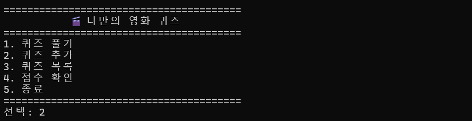
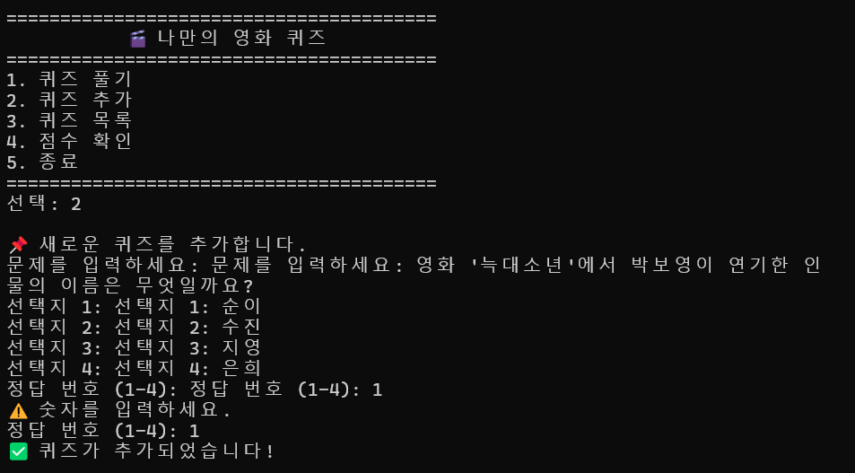
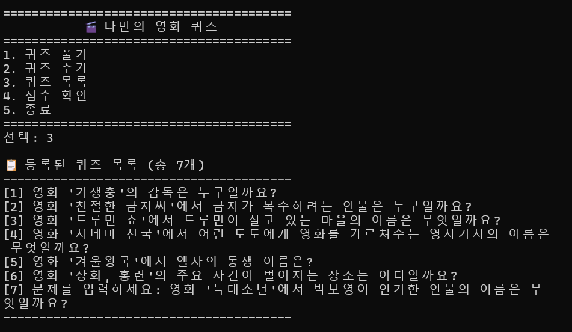
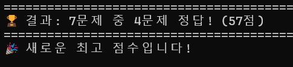
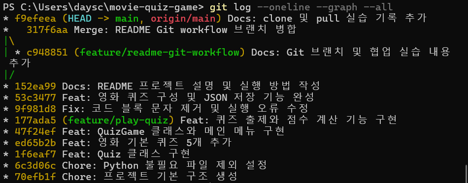
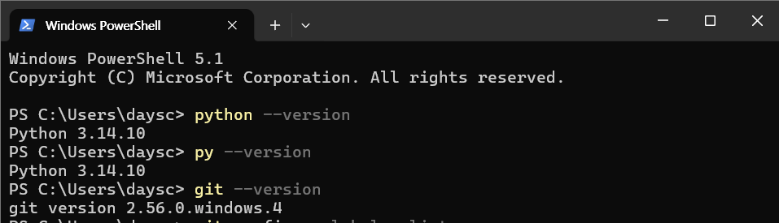

# 🎬 나만의 영화 퀴즈 게임

Python 기본 문법, 클래스, JSON 파일 입출력, 예외 처리와 Git을 활용해 만든 콘솔 기반 영화 퀴즈 게임입니다.

## 프로젝트 개요

프로그램을 실행하면 메뉴에서 번호를 선택하여 **퀴즈 풀기 / 퀴즈 추가 / 퀴즈 목록 / 점수 확인 / 종료** 기능을 사용할 수 있습니다.

퀴즈와 최고 점수는 프로젝트 루트의 `state.json`에 UTF-8 JSON 형식으로 저장되므로 프로그램을 종료한 뒤 다시 실행해도 데이터가 유지됩니다.

## 퀴즈 주제와 선정 이유

- **주제:** 영화
- **선정 이유:** 평소 영화를 좋아해서 재미있게 문제를 만들 수 있을 것 같아서 영화라는 주제를 선정했습니다.

기본 퀴즈에는 `기생충`, `친절한 금자씨`, `트루먼 쇼`, `시네마 천국`, `겨울왕국`, `장화, 홍련`, `늑대소년` 관련 문제가 들어 있습니다.

## 실행 방법

### 실행 환경

- Python 3.10 이상
- 외부 라이브러리 없음

프로젝트 폴더에서 다음 명령어를 실행합니다.

```bash
python main.py
```

## 기능 목록

1. **퀴즈 풀기**
   - 저장된 영화 퀴즈를 순서대로 출제합니다.
   - 각 문제는 4개의 선택지를 제공합니다.
   - 정답/오답을 즉시 알려줍니다.
   - 모든 문제를 풀면 정답 수와 100점 기준 점수를 표시합니다.
   - 기존 최고 점수보다 높으면 최고 점수를 갱신합니다.

2. **퀴즈 추가**
   - 문제, 선택지 4개, 정답 번호를 입력해 새 퀴즈를 추가합니다.
   - 추가한 퀴즈는 즉시 `state.json`에 저장됩니다.

3. **퀴즈 목록**
   - 현재 저장된 모든 퀴즈의 문제를 번호와 함께 확인할 수 있습니다.

4. **점수 확인**
   - 최고 점수와 당시 정답 수/전체 문제 수를 확인할 수 있습니다.
   - 아직 퀴즈를 풀지 않았다면 별도 안내 메시지를 출력합니다.

5. **입력 및 오류 처리**
   - 숫자 입력 앞뒤 공백을 제거합니다.
   - 빈 입력, 문자가 입력된 경우, 범위를 벗어난 숫자를 처리합니다.
   - `Ctrl+C`와 `EOFError`가 발생해도 가능한 범위에서 데이터를 저장한 뒤 안전하게 종료합니다.
   - `state.json`이 없으면 기본 퀴즈를 사용합니다.
   - `state.json`이 손상되면 안내 메시지를 출력하고 기본 데이터로 복구합니다.

## 메뉴 화면 예시

```text
========================================
        🎬 나만의 영화 퀴즈 🎬
========================================
1. 퀴즈 풀기
2. 퀴즈 추가
3. 퀴즈 목록
4. 점수 확인
5. 종료
========================================
선택:
```

## 퀴즈 풀기 예시

```text
선택: 1

📝 퀴즈를 시작합니다! (총 7문제)

----------------------------------------
[문제 1]
영화 '기생충'의 감독은 누구일까요?

1. 박찬욱
2. 이창동
3. 봉준호
4. 최동훈

정답 입력 (1-4): 3
✅ 정답입니다!

... (중략) ...

========================================
🏆 결과: 7문제 중 4문제 정답! (57점)
🎉 새로운 최고 점수입니다!
========================================
```

## 퀴즈 추가 예시

```text
선택: 2

📌 새로운 퀴즈를 추가합니다.

문제를 입력하세요: 영화 '늑대소년'에서 박보영이 연기한 인물의 이름은 무엇일까요?
선택지 1: 순이
선택지 2: 수진
선택지 3: 지영
선택지 4: 은희
정답 번호 (1-4): 1

✅ 퀴즈가 추가되었습니다!
```

## 퀴즈 목록 예시

```text
선택: 3

📋 등록된 퀴즈 목록 (총 7개)
----------------------------------------
[1] 영화 '기생충'의 감독은 누구일까요?
[2] 영화 '친절한 금자씨'에서 금자가 복수하려는 인물은 누구일까요?
[3] 영화 '트루먼 쇼'에서 트루먼이 살고 있는 마을의 이름은 무엇일까요?
[4] 영화 '시네마 천국'에서 어린 토토에게 영화를 가르쳐주는 영사기사의 이름은 무엇일까요?
[5] 영화 '겨울왕국'에서 엘사의 동생 이름은 무엇일까요?
[6] 영화 '장화, 홍련'의 주요 사건이 벌어지는 장소는 어디일까요?
[7] 영화 '늑대소년'에서 박보영이 연기한 인물의 이름은 무엇일까요?
----------------------------------------
```

## 점수 확인 예시

```text
선택: 4

🏆 최고 점수: 57점 (7문제 중 4문제 정답)
```

## 잘못된 입력 처리 예시

```text
선택: abc
⚠️ 잘못된 입력입니다. 1-5 사이의 숫자를 입력하세요.

선택: 9
⚠️ 잘못된 입력입니다. 1-5 사이의 숫자를 입력하세요.
```

## 프로그램 재시작 후 데이터 유지 예시

```text
📂 저장된 데이터를 불러왔습니다. (퀴즈 7개, 최고점수 57점)

========================================
        🎬 나만의 영화 퀴즈 🎬
========================================
1. 퀴즈 풀기
2. 퀴즈 추가
3. 퀴즈 목록
4. 점수 확인
5. 종료
========================================
```

## 파일 구조

```text
movie-quiz-game/
├── main.py
├── state.json
├── README.md
├── .gitignore
└── docs/
    └── screenshots/
        ├── menu.png
        ├── play.png
        ├── add_quiz.png
        ├── score.png
        ├── quiz_list.png
        ├── git_log.png
        └── environment.png
```

### 파일 역할

- `main.py`: `Quiz`, `QuizGame` 클래스와 메뉴/플레이/추가/목록/점수/저장 로직
- `state.json`: 퀴즈 목록과 최고 점수를 저장하는 데이터 파일
- `README.md`: 프로젝트 설명과 실행 방법, 기능 및 실행 화면 정리
- `.gitignore`: Git에 포함하지 않을 Python 임시 파일 등을 지정
- `docs/screenshots/`: 제출용 실행 화면 캡처

## `state.json` 데이터 설명

`state.json`은 프로젝트 루트에 위치하며 UTF-8 인코딩으로 저장됩니다.

```json
{
    "quizzes": [
        {
            "question": "영화 '기생충'의 감독은 누구일까요?",
            "choices": ["박찬욱", "이창동", "봉준호", "최동훈"],
            "answer": 3
        }
    ],
    "best_score": 57,
    "best_correct": 4,
    "best_total": 7
}
```

- `quizzes`: 전체 퀴즈 목록
- `question`: 문제 문장
- `choices`: 4개의 선택지
- `answer`: 정답 번호(1~4)
- `best_score`: 최고 점수(100점 기준)
- `best_correct`: 최고 기록의 정답 수
- `best_total`: 최고 기록 당시 전체 문제 수

## 클래스 구조

### `Quiz`

개별 퀴즈 한 문제를 표현합니다.

- 속성: `question`, `choices`, `answer`
- 주요 메서드: 문제 출력, 정답 확인, 딕셔너리 변환

### `QuizGame`

게임 전체 흐름과 저장 데이터를 관리합니다.

- 속성: 퀴즈 목록, 최고 점수, 최고 정답 수, 전체 문제 수
- 주요 메서드: 메뉴, 퀴즈 풀기, 추가, 목록, 점수 확인, 저장/불러오기, 입력 검증

## Git 실습

프로젝트 개발 과정에서 기능 단위 커밋을 10회 이상 작성하고, 별도 브랜치를 생성한 뒤 `main` 브랜치에 병합했습니다. 또한 GitHub 저장소를 `clone`한 뒤 복제된 저장소에서 변경사항을 `push`하고 기존 작업 폴더에서 `pull`하는 흐름을 실습했습니다.

## 실행 화면

### 메뉴



### 퀴즈 추가



### 퀴즈 목록



### 퀴즈 플레이 결과



### 점수 결과


### Git 로그



### 개발 환경


